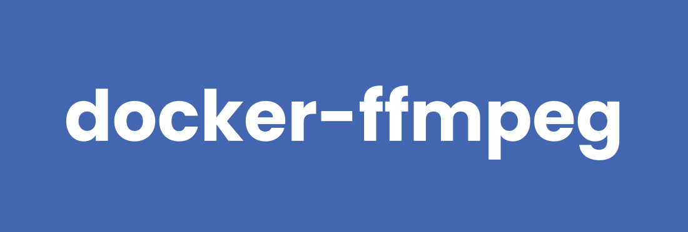

# docker-ffmpeg



[](https://github.com/RagedUnicorn/docker-ffmpeg/actions/workflows/docker_release.yml)
[](https://github.com/RagedUnicorn/docker-ffmpeg/actions/workflows/test.yml)


> Docker Alpine image with FFmpeg and its dependencies.


## Overview

This Docker image provides a lightweight FFmpeg installation built from source on Alpine Linux. It includes a comprehensive set of codecs and libraries for versatile media processing capabilities.

## Features

- **Small footprint**: ~55MB compressed (~190MB on disk) runtime image using Alpine Linux
- **FFmpeg**: Latest stable version compiled from source
- **Extensive codec support**: x264, x265, VP9, AV1, Opus, MP3, AAC, and more
- **Multi-stage build**: Optimized for minimal final image size
- **Volume mounting**: Easy file input/output through `/tmp/workdir`

## Supported Codecs

### Video Codecs
- H.264 (libx264)
- H.265/HEVC (libx265)
- VP8/VP9 (libvpx)
- AV1 (libaom, libsvtav1; decoding via libdav1d)
- Theora (libtheora)

### Audio Codecs
- AAC (FFmpeg native `aac` encoder)
- MP3 (libmp3lame)
- Opus (libopus)
- Vorbis (libvorbis)

### Additional Features
- Subtitles (libass)
- Text rendering with `drawtext` (libfreetype, libharfbuzz, libfontconfig, DejaVu fonts)
- WebP support (libwebp)
- AVIF image output (via libaom)
- RTMP streaming (librtmp)
- SSL/TLS support (openssl)

## Quick Start

```bash
# Pull the image
docker pull ragedunicorn/ffmpeg:latest

# Run FFmpeg
docker run -v $(pwd):/tmp/workdir ragedunicorn/ffmpeg:latest -i input.mp4 output.mp4
```

On Windows, use the PowerShell form:

```powershell
# Pull the image
docker pull ragedunicorn/ffmpeg:latest

# Run FFmpeg
docker run -v "${PWD}:/tmp/workdir" ragedunicorn/ffmpeg:latest -i input.mp4 output.mp4
```

Write `${PWD}` **with braces** and keep the colon inside the quotes - without
braces PowerShell parses `$PWD:` as a scope-qualified variable (as in
`$env:PATH`) and rejects the argument. See the
[Windows (PowerShell) notes](#windows-powershell-notes) for details.

For development and building from source, see [DEVELOPMENT.md](DEVELOPMENT.md).

## Usage

The container uses FFmpeg as the entrypoint, so any FFmpeg parameters can be passed directly to the `docker run` command.

### Basic Usage

```bash
# Using latest version
docker run -v $(pwd):/tmp/workdir ragedunicorn/ffmpeg:latest [ffmpeg-options]

# Using specific FFmpeg version (latest Alpine build)
docker run -v $(pwd):/tmp/workdir ragedunicorn/ffmpeg:<ffmpeg-version> [ffmpeg-options]

# Using exact version combination
docker run -v $(pwd):/tmp/workdir ragedunicorn/ffmpeg:<ffmpeg-version>-alpine<alpine-version>-<build> [ffmpeg-options]
```

PowerShell:

```powershell
# Using latest version
docker run -v "${PWD}:/tmp/workdir" ragedunicorn/ffmpeg:latest [ffmpeg-options]

# Using specific FFmpeg version (latest Alpine build)
docker run -v "${PWD}:/tmp/workdir" ragedunicorn/ffmpeg:<ffmpeg-version> [ffmpeg-options]

# Using exact version combination
docker run -v "${PWD}:/tmp/workdir" ragedunicorn/ffmpeg:<ffmpeg-version>-alpine<alpine-version>-<build> [ffmpeg-options]
```

Available tags are listed on [Docker Hub](https://hub.docker.com/r/ragedunicorn/ffmpeg/tags) and in the
[GitHub releases](https://github.com/RagedUnicorn/docker-ffmpeg/releases).

### Examples

#### Convert Video Format
```bash
docker run -v $(pwd):/tmp/workdir ragedunicorn/ffmpeg:latest -i input.mp4 -c:v libx264 -c:a aac output.mp4
```

#### Get Video Information
```bash
docker run -v $(pwd):/tmp/workdir ragedunicorn/ffmpeg:latest -i input.mp4
```

#### Extract Audio
```bash
docker run -v $(pwd):/tmp/workdir ragedunicorn/ffmpeg:latest -i input.mp4 -vn -acodec mp3 output.mp3
```

#### Resize Video
```bash
docker run -v $(pwd):/tmp/workdir ragedunicorn/ffmpeg:latest -i input.mp4 -vf scale=1280:720 output.mp4
```

#### Convert to WebM
```bash
docker run -v $(pwd):/tmp/workdir ragedunicorn/ffmpeg:latest -i input.mp4 -c:v libvpx -c:a libvorbis output.webm
```

#### Create GIF from Video
```bash
docker run -v $(pwd):/tmp/workdir ragedunicorn/ffmpeg:latest -i input.mp4 -vf "fps=10,scale=320:-1" output.gif
```

#### Convert Image to AVIF
```bash
docker run -v $(pwd):/tmp/workdir ragedunicorn/ffmpeg:latest -i input.png -c:v libaom-av1 -still-picture 1 output.avif
```

#### Encode AV1 Video
```bash
docker run -v $(pwd):/tmp/workdir ragedunicorn/ffmpeg:latest -i input.mp4 -c:v libsvtav1 -preset 6 -crf 32 -c:a libopus output.mkv
```

#### PowerShell

The same examples in PowerShell form:

```powershell
# Convert video format
docker run -v "${PWD}:/tmp/workdir" ragedunicorn/ffmpeg:latest -i input.mp4 -c:v libx264 -c:a aac output.mp4

# Get video information
docker run -v "${PWD}:/tmp/workdir" ragedunicorn/ffmpeg:latest -i input.mp4

# Extract audio
docker run -v "${PWD}:/tmp/workdir" ragedunicorn/ffmpeg:latest -i input.mp4 -vn -acodec mp3 output.mp3

# Resize video
docker run -v "${PWD}:/tmp/workdir" ragedunicorn/ffmpeg:latest -i input.mp4 -vf scale=1280:720 output.mp4

# Convert to WebM
docker run -v "${PWD}:/tmp/workdir" ragedunicorn/ffmpeg:latest -i input.mp4 -c:v libvpx -c:a libvorbis output.webm

# Create GIF from video
docker run -v "${PWD}:/tmp/workdir" ragedunicorn/ffmpeg:latest -i input.mp4 -vf "fps=10,scale=320:-1" output.gif

# Convert image to AVIF
docker run -v "${PWD}:/tmp/workdir" ragedunicorn/ffmpeg:latest -i input.png -c:v libaom-av1 -still-picture 1 output.avif

# Encode AV1 video
docker run -v "${PWD}:/tmp/workdir" ragedunicorn/ffmpeg:latest -i input.mp4 -c:v libsvtav1 -preset 6 -crf 32 -c:a libopus output.mkv
```

### Windows (PowerShell) notes

The PowerShell variants above differ from the bash ones only in the mount,
which is written `-v "${PWD}:/tmp/workdir"` instead of `-v $(pwd):/tmp/workdir`.
The FFmpeg arguments themselves are unchanged.

The mount spelling matters:

- Pasting the bash form into PowerShell breaks: an argument that starts with
  `$(pwd)` ends after the subexpression, so `$(pwd):/tmp/workdir` reaches
  Docker as two arguments (`C:\path` and `:/tmp/workdir`).
- `"$PWD:/tmp/workdir"` without braces is a parse error: PowerShell reads a
  colon after a variable as a scope qualifier (as in `$env:PATH`), and `/` is
  not a valid variable-name character.
- `"${PWD}:/tmp/workdir"` works: the braces end the variable name at `PWD`,
  the colon stays literal, and Docker splits the resulting
  `C:\path:/tmp/workdir` on the second colon because it recognises the `C:`
  drive prefix.

Filter arguments such as `-vf "fps=10,scale=320:-1"` can keep their double
quotes - they contain nothing PowerShell expands. Quote any filter string that
contains `$` with single quotes instead, so PowerShell passes it through
literally.

To check what the container actually sees under `/tmp/workdir`, run a
look-inside command:

```powershell
docker run --rm -v "${PWD}:/tmp/workdir" --entrypoint sh ragedunicorn/ffmpeg:latest -c 'pwd; ls -la /tmp/workdir'
```

The single quotes keep `pwd; ls -la /tmp/workdir` as one literal argument to
the container's `sh`, so the `;` runs inside the container - unquoted,
PowerShell would treat `;` as its own statement separator and run
`ls -la /tmp/workdir` on the host.

For more complex invocations where PowerShell keeps mangling arguments, the
[stop-parsing token `--%`](https://learn.microsoft.com/en-us/powershell/module/microsoft.powershell.core/about/about_parsing#the-stop-parsing-token)
is an escape hatch: PowerShell passes everything after it verbatim. Nothing
after `--%` is expanded - including `${PWD}` - so it cannot be combined with
the mount examples above; none of the examples in this README need it.

## Docker Compose Usage

This repository includes Docker Compose configurations for easier usage and common media processing workflows.

### Basic Setup

1. Create a `media` directory structure:
```bash
mkdir -p media/input media/output
```

PowerShell:
```powershell
New-Item -ItemType Directory -Force media/input, media/output
```

2. Place your input files in `media/input/`

3. Run FFmpeg using docker compose:
```bash
docker compose run --rm ffmpeg -i input/video.mp4 output/converted.mp4
```

### Example Configurations

The `examples/` directory contains specialized docker-compose files for common tasks:

#### Video Conversion (`examples/docker-compose.convert.yml`)
```bash
# Convert MP4 to WebM
docker compose -f examples/docker-compose.convert.yml run --rm mp4-to-webm

# Compress video
docker compose -f examples/docker-compose.convert.yml run --rm compress-video

# Convert to H.265
docker compose -f examples/docker-compose.convert.yml run --rm convert-to-h265
```

#### Media Extraction (`examples/docker-compose.extract.yml`)
```bash
# Extract audio from video
docker compose -f examples/docker-compose.extract.yml run --rm extract-audio-mp3

# Extract video thumbnails
docker compose -f examples/docker-compose.extract.yml run --rm extract-thumbnails

# Extract specific segment
START_TIME=00:01:30 DURATION=00:00:45 docker compose -f examples/docker-compose.extract.yml run --rm extract-segment
```

#### Streaming (`examples/docker-compose.stream.yml`)
```bash
# Stream to RTMP server
# Use environment variables or secret management tools
# Example: export STREAM_KEY="your-actual-key" before running
RTMP_URL=rtmp://your.server/live/ STREAM_KEY=${STREAM_KEY} docker compose -f examples/docker-compose.stream.yml run --rm rtmp-stream

# Create HLS stream
docker compose -f examples/docker-compose.stream.yml run --rm hls-stream
```

#### Batch Processing (`examples/docker-compose.batch.yml`)
```bash
# Compress all videos in input directory
docker compose -f examples/docker-compose.batch.yml run --rm batch-compress-all

# Generate thumbnails for all videos
docker compose -f examples/docker-compose.batch.yml run --rm batch-generate-thumbnails

# Custom batch processing
FFMPEG_ARGS="-c:v libx265 -crf 28" docker compose -f examples/docker-compose.batch.yml run --rm batch-custom
```

#### PowerShell

The compose commands without a `VAR=value` prefix run unchanged in PowerShell.
PowerShell has no inline environment prefix, so set the variables in the
session first (they stay set until you close the window or
`Remove-Item Env:NAME`):

```powershell
# Extract specific segment
$env:START_TIME = "00:01:30"; $env:DURATION = "00:00:45"
docker compose -f examples/docker-compose.extract.yml run --rm extract-segment

# Stream to RTMP server (set $env:STREAM_KEY beforehand, e.g. from a secret store)
$env:RTMP_URL = "rtmp://your.server/live/"
docker compose -f examples/docker-compose.stream.yml run --rm rtmp-stream

# Custom batch processing
$env:FFMPEG_ARGS = "-c:v libx265 -crf 28"
docker compose -f examples/docker-compose.batch.yml run --rm batch-custom
```

### Environment Variables

Many compose services support environment variables for customization:

- `FFMPEG_VERSION`: Specify FFmpeg image version (default: latest)
- `CRF`: Compression quality (lower = better quality, larger file)
- `PRESET`: Encoding speed preset (ultrafast, fast, medium, slow)
- `RTMP_URL`: RTMP server URL for streaming
- `START_TIME`, `DURATION`: For segment extraction
- See individual compose files for more options

### Tips

1. **Custom Commands**: Override the default command:
   ```bash
   docker compose run --rm ffmpeg -i input/video.mp4 -vf scale=640:480 output/small.mp4
   ```

2. **Multiple Files**: Use the batch processing configurations for processing multiple files efficiently

3. **Persistent Settings**: The repository includes a `.env` file that sets `FFMPEG_VERSION` (plus the test harness version). Docker Compose reads it automatically, so change the version there and add any of the variables above you want to persist:
   ```env
   FFMPEG_VERSION=<ffmpeg-version>-alpine<alpine-version>-<build>
   RTMP_URL=rtmp://streaming.server/live/
   ```

## Versioning

This project uses semantic versioning that matches the Docker image contents:

**Format:** `{ffmpeg_version}-alpine{alpine_version}-{build_number}`

Examples (`X.Y.Z` is the FFmpeg version, `A.B.C` the Alpine version):
- `X.Y.Z-alpineA.B.C-1` - FFmpeg X.Y.Z on Alpine A.B.C, build 1
- `X.Y.Z` - Most recent build of FFmpeg X.Y.Z
- `latest` - Most recent stable release

The current tags are listed on [Docker Hub](https://hub.docker.com/r/ragedunicorn/ffmpeg/tags).

For detailed release process and versioning guidelines, see [RELEASE.md](RELEASE.md).

## Image Verification

Released images are signed with [cosign](https://docs.sigstore.dev/) keyless signing and carry SBOM and provenance attestations.

```bash
# Verify the signature (works for both ghcr.io/ragedunicorn/docker-ffmpeg and ragedunicorn/ffmpeg)
cosign verify ragedunicorn/ffmpeg:latest \
  --certificate-identity-regexp '^https://github.com/RagedUnicorn/docker-ffmpeg/\.github/workflows/docker_release\.yml@refs/tags/v' \
  --certificate-oidc-issuer https://token.actions.githubusercontent.com

# Inspect the SBOM and provenance attestations
docker buildx imagetools inspect ragedunicorn/ffmpeg:latest --format '{{ json .SBOM }}'
docker buildx imagetools inspect ragedunicorn/ffmpeg:latest --format '{{ json .Provenance }}'
```

## Automated Dependency Updates

This project uses [Renovate](https://docs.renovatebot.com/) to automatically check for updates to:
- Alpine Linux base image version (all major, minor, and patch updates)
- FFmpeg version

Renovate runs weekly (every Monday) and creates pull requests when updates are available. The configuration tracks 
both Alpine Linux and FFmpeg releases, creating separate pull requests for each update.

## Documentation

- [Development Guide](DEVELOPMENT.md) - Building, debugging, and contributing
- [Testing Guide](TEST.md) - Running and writing tests
- [Release Process](RELEASE.md) - Creating releases and versioning

## Links

- [FFmpeg Documentation](https://ffmpeg.org/documentation.html)
- [Alpine Linux](https://www.alpinelinux.org/)

# License

The FFmpeg binaries shipped in the image are built with `--enable-gpl --enable-version3` and are licensed under GPL-3.0-or-later. No non-free components (such as libfdk-aac) are included, so the image can be redistributed. See [FFmpeg License and Legal Considerations](https://ffmpeg.org/legal.html).

The contents of this repository (Dockerfile, tests, documentation) are licensed under the MIT License:

MIT License

Copyright (c) 2026 Michael Wiesendanger

Permission is hereby granted, free of charge, to any person obtaining
a copy of this software and associated documentation files (the
"Software"), to deal in the Software without restriction, including
without limitation the rights to use, copy, modify, merge, publish,
distribute, sublicense, and/or sell copies of the Software, and to
permit persons to whom the Software is furnished to do so, subject to
the following conditions:

The above copyright notice and this permission notice shall be
included in all copies or substantial portions of the Software.

THE SOFTWARE IS PROVIDED "AS IS", WITHOUT WARRANTY OF ANY KIND,
EXPRESS OR IMPLIED, INCLUDING BUT NOT LIMITED TO THE WARRANTIES OF
MERCHANTABILITY, FITNESS FOR A PARTICULAR PURPOSE AND
NONINFRINGEMENT. IN NO EVENT SHALL THE AUTHORS OR COPYRIGHT HOLDERS BE
LIABLE FOR ANY CLAIM, DAMAGES OR OTHER LIABILITY, WHETHER IN AN ACTION
OF CONTRACT, TORT OR OTHERWISE, ARISING FROM, OUT OF OR IN CONNECTION
WITH THE SOFTWARE OR THE USE OR OTHER DEALINGS IN THE SOFTWARE.
